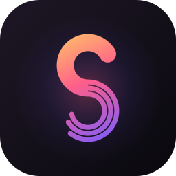
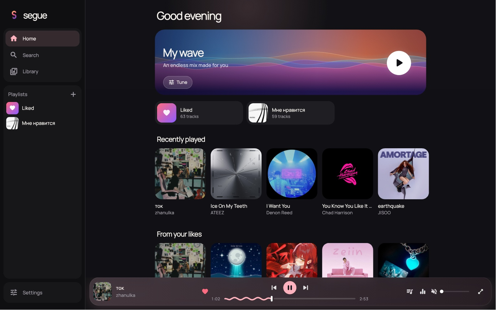

<p align="center">
  
</p>

<h1 align="center">Segue</h1>

<p align="center">
  <b>One music player for everything you listen to.</b><br>
  YouTube and SoundCloud in one search, your Spotify and Yandex Music library,<br>
  in sync across your computer and phone. Free, open source, no account, no server.
</p>

<p align="center">
  <a href="https://github.com/segue-app/segue/releases/latest"></a>
  <a href="https://github.com/segue-app/segue/releases"></a>
  <a href="https://github.com/segue-app/segue/actions/workflows/ci.yml"></a>
  
  <a href="LICENSE"></a>
</p>

<p align="center">
  <a href="#download">Download</a> ·
  <a href="#features">Features</a> ·
  <a href="#how-it-works">How it works</a> ·
  <a href="#build-from-source">Build</a> ·
  <a href="README.ru.md">Русский</a>
</p>

<p align="center">
  
</p>

<p align="center">
  
  &nbsp;
  
  &nbsp;
  
</p>

## Why Segue

- **Everything in one place.** One search across YouTube and SoundCloud, and
  your playlists and likes from Spotify and Yandex Music.
- **Yours, not a service's.** No account, no subscription, no Segue server.
  Your library is a file on your device.
- **All your devices as one player.** Start on the laptop, continue on the
  phone at the same second, or use the phone as a remote.
- **In your language.** English and Russian, switched in Settings.
- **Light.** About 0.3% CPU when paused and no drawing at all while its window is
  hidden (measured on an Apple Silicon MacBook).

## Download

Get the latest build from **[Releases](https://github.com/segue-app/segue/releases/latest)**.
After the first install, Segue updates itself: **Settings → Update**.

| Platform | File | Notes |
| --- | --- | --- |
| **Android** | `segue-android-arm64.apk` | Most phones. Older ones: `-armv7`; emulators: `-x86_64` |
| **Windows** | `segue-windows-x64.zip` | Unzip anywhere and run `segue.exe` |
| **macOS** | `segue-macos.zip` | Unzip and move to Applications. The app isn't notarized: the first time, right-click → **Open** |
| **Linux** | `segue-linux-x64.tar.gz` | Needs libmpv: `sudo apt install libmpv2` |

iOS has no prebuilt app (it needs Apple signing); you can
[build it from source](#build-from-source).

## Features

### Listen

- **One search** across YouTube and SoundCloud, with source filters
- Artist and album pages, charts by genre, similar artists
- **My wave**: an endless mix that learns from you. Songs you play to the
  end bring more of that artist, songs you skip bring less, and 👎 removes
  a song for good. Tune it by activity, mood, character and language
- **Import** playlists by link from Spotify, Yandex Music, YouTube and
  SoundCloud, or your whole library (a Yandex Music profile, Spotify via
  Exportify or your data export). Imported songs are matched to the right
  version automatically, and you can pick another one by hand
- **Offline**: download what you want, and the songs you played recently are
  kept on the device by themselves (they start at once and play without
  internet)
- Your own music folders

### Sound

- **Gapless playback**: live albums and mixes flow without a pause
- **DJ-style mixing**: overlapping crossfades with the next song brought to
  the current tempo, spoken intros and end skits of music videos skipped
- **Even loudness**: quiet and loud tracks play at the same level
- 10-band equalizer with presets, speed and pitch
- Trim any track to the part you want
- Sleep timer that fades out

### Lyrics

- **Word-by-word** highlighting, karaoke style, when timing is available;
  line-by-line otherwise
- Line-by-line translation
- A 3D side-by-side layout on wide screens; animation, size and glow are
  adjustable

<p align="center">
  
</p>

### Your devices

- **Pair** with an 8-character code or a QR, on any network (Wi-Fi or
  mobile data)
- **Sync**: likes, playlists with their order, and history
- **Connect**: see what plays where, move the music with one tap and it
  continues at the same moment; the player on one device is the remote for
  another
- **Listen together**: share a code and friends hear the same song at the
  same second on their own devices, and add to the shared queue

### Desktop and home screen

- MacBook **living notch**: now playing around the camera; hover for
  controls, scroll for volume, swipe to skip
- Desktop now-playing card on macOS, home-screen widget on Android
- Keyboard shortcuts:

  | Key | Action |
  | --- | --- |
  | `Space` | Play / pause |
  | `←` `→` | Seek 5 seconds |
  | `⌘/Ctrl` + `←` `→` | Previous / next track |
  | `⌘/Ctrl` + `↑` `↓` | Volume |
  | `M` | Mute |
  | `L` | Like |
  | `⌘/Ctrl` + `F` | Search |

### Integrations

- Last.fm scrobbling (with your own API key)
- Discord "Listening to" status (Windows, Linux)
- In-app updates from GitHub releases

## Privacy

- **No account and no Segue server.** The app talks to the music services
  directly from your device.
- **No analytics, no ads, no tracking.**
- **Sync is end-to-end encrypted.** Across networks it goes through public
  MQTT brokers, which only see random topic names and AES-256-GCM
  ciphertext; the key exists only on your devices. On the same Wi-Fi the
  devices talk to each other directly.

## How it works

| Part | How |
| --- | --- |
| **Playback** | [media_kit](https://github.com/media-kit/media-kit) (libmpv) on every platform, so the equalizer and effects are the same FFmpeg filters everywhere. A loopback proxy keeps HLS streams on one connection and preloads the next track; the next song is queued inside mpv for gapless playback |
| **Sources** | YouTube through its player API, SoundCloud through its public web API. The catalogue, charts, waves and album covers come from Deezer's public API; those songs are matched on YouTube when they play |
| **Matching** | An imported song is found by title, artist and length, preferring the artist's own channel and rejecting covers, live versions and remixes. The chosen version travels with the song when playback moves to another device |
| **Lyrics** | Word timing from NetEase Cloud Music when it has the song, line timing from [LRCLIB](https://lrclib.net) otherwise; both are checked against title, artist and length |
| **Library** | SQLite on the device. Sync merges per item; the newest change wins |
| **Sync** | Bonjour/mDNS on the local network; across networks, two public MQTT brokers at once (HiveMQ and EMQX), so either can be down. Invite codes are stretched with PBKDF2 and expire after 10 minutes |
| **Performance** | Decorative motion runs on one shared 30 fps beat and stops when paused or out of sight; covers are cached on disk and fetched at the size shown |

```
lib/
  core/      sources, player, library, sync, catalog, lyrics, integrations
  ui/        screens, widgets, theme
test/                unit tests
integration_test/    real playback (muted) and screenshot runs on a desktop
```

## Build from source

Requirements: [Flutter](https://flutter.dev) 3.47 or newer.

```sh
git clone https://github.com/segue-app/segue.git
cd segue
flutter pub get
flutter run                  # on a connected device or this computer
```

Release builds:

```sh
flutter build apk --release --split-per-abi   # Android
flutter build windows --release               # Windows
flutter build linux --release                 # Linux (apt install libmpv-dev)
flutter build macos --release                 # macOS (needs CocoaPods)
flutter build ios --release                   # iOS (needs signing)
```

<details>
<summary>Optional build settings</summary>

**Discord status** needs an application id from
[discord.com/developers](https://discord.com/developers/applications):

```sh
flutter build windows --release --dart-define=DISCORD_CLIENT_ID=<your id>
```

**Android signing.** Without a key the APK is signed with debug keys. For
your own permanent key, create `android/key.properties`:

```properties
storeFile=/path/to/your.jks
storePassword=...
keyAlias=...
keyPassword=...
```

</details>

## Tests

```sh
flutter test --exclude-tags live            # fast, offline
flutter test --tags live                    # talks to the real services
flutter test integration_test/playback_test.dart -d macos   # real playback, muted
```

## Contributing

Issues and pull requests are welcome. Before opening a pull request, please
run `flutter analyze` and `flutter test --exclude-tags live`; both must be
clean. For a bug, say which platform and version you're on and what you did
right before it happened.

## Disclaimer

Segue is a client for content that is publicly available on the services it
connects to. It does not host, store or redistribute any media. Respect the
terms of those services and the rights of artists in your country.

## License

[GPL-3.0](LICENSE)
