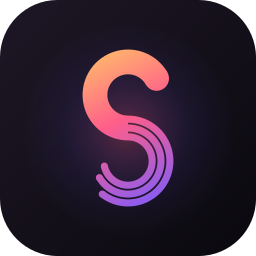
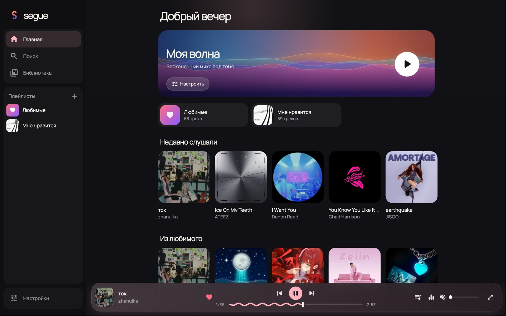
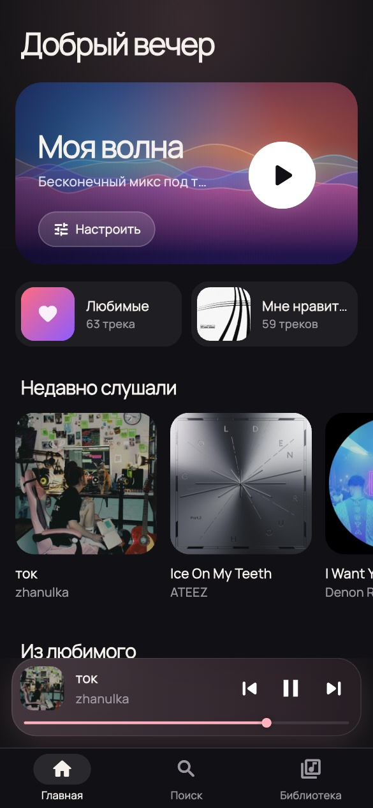
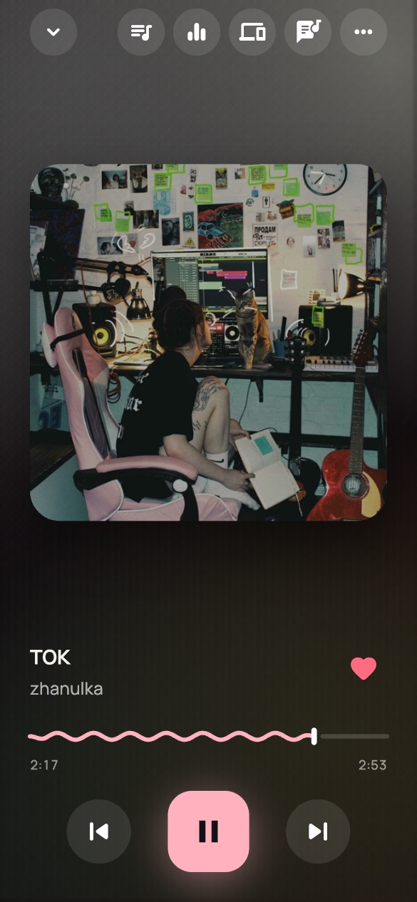
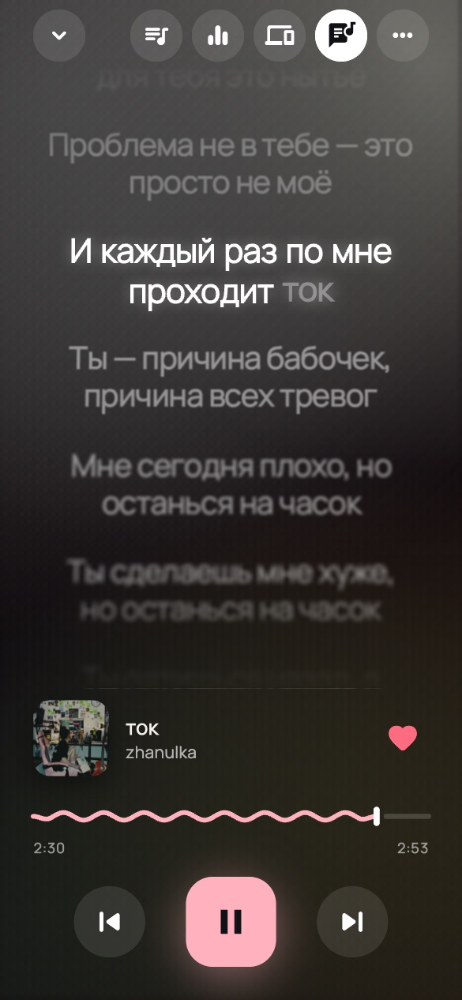
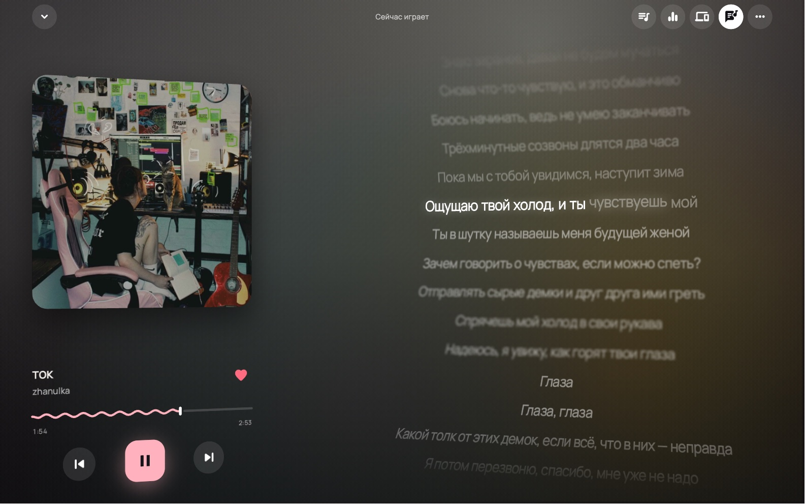

<p align="center">
  
</p>

<h1 align="center">Segue</h1>

<p align="center">
  <b>Один плеер для всей твоей музыки.</b><br>
  YouTube и SoundCloud в одном поиске, библиотека из Spotify и Яндекс Музыки,<br>
  синхронизация между компьютером и телефоном. Бесплатно, с открытым кодом, без аккаунта и сервера.
</p>

<p align="center">
  <a href="https://github.com/segue-app/segue/releases/latest"></a>
  <a href="https://github.com/segue-app/segue/releases"></a>
  <a href="https://github.com/segue-app/segue/actions/workflows/ci.yml"></a>
  
  <a href="LICENSE"></a>
</p>

<p align="center">
  <a href="#скачать">Скачать</a> ·
  <a href="#возможности">Возможности</a> ·
  <a href="#как-это-устроено">Как это устроено</a> ·
  <a href="#сборка-из-исходников">Сборка</a> ·
  <a href="README.md">English</a>
</p>

<p align="center">
  
</p>

<p align="center">
  
  &nbsp;
  
  &nbsp;
  
</p>

## Зачем Segue

- **Всё в одном месте.** Один поиск по YouTube и SoundCloud, плюс твои
  плейлисты и лайки из Spotify и Яндекс Музыки.
- **Твоё, а не сервиса.** Без аккаунта, подписки и сервера Segue.
  Библиотека хранится файлом на твоём устройстве.
- **Все устройства как один плеер.** Начни на ноутбуке и продолжи на
  телефоне с той же секунды, или управляй ноутбуком с телефона.
- **На твоём языке.** Русский и английский, переключается в настройках.
- **Лёгкий.** Около 0,3% процессора на паузе, а пока окно скрыто, ничего не
  рисуется (замер на MacBook с Apple Silicon).

## Скачать

Последняя сборка лежит в **[релизах](https://github.com/segue-app/segue/releases/latest)**.
После первой установки Segue обновляется сам: **Настройки → Обновить**.

| Платформа | Файл | Примечание |
| --- | --- | --- |
| **Android** | `segue-android-arm64.apk` | Почти все телефоны. Старые: `-armv7`, эмуляторы: `-x86_64` |
| **Windows** | `segue-windows-x64.zip` | Распакуй куда угодно и запусти `segue.exe` |
| **macOS** | `segue-macos.zip` | Распакуй и перенеси в «Программы». Приложение не нотаризовано: в первый раз открой через правый клик → **Открыть** |
| **Linux** | `segue-linux-x64.tar.gz` | Нужен libmpv: `sudo apt install libmpv2` |

Готовой сборки для iOS нет (нужна подпись Apple), но её можно
[собрать из исходников](#сборка-из-исходников).

## Возможности

### Музыка

- **Один поиск** по YouTube и SoundCloud, с фильтром по источнику
- Страницы артистов и альбомов, чарты по жанрам, похожие артисты
- **Моя волна**: бесконечный микс, который учится на тебе. Дослушал трек
  до конца — этого артиста станет больше, пропустил — меньше, а 👎 убирает
  песню насовсем. Настраивается по занятию, настроению, характеру и языку
- **Импорт** плейлистов по ссылке из Spotify, Яндекс Музыки, YouTube и
  SoundCloud, или всей библиотеки (профиль Яндекс Музыки, Spotify через
  Exportify или выгрузку данных). Нужная версия песни подбирается
  автоматически, а при ошибке её можно выбрать вручную
- **Офлайн**: скачивай что хочешь, а недавно прослушанные треки сохраняются
  на устройстве сами (запускаются мгновенно и играют без интернета)
- Свои папки с музыкой

### Звук

- **Без пауз между треками**: концертные альбомы и миксы идут сплошным
  потоком
- **Сведение как у диджея**: плавные переходы с подстройкой темпа следующей
  песни, пропуск разговорных вступлений и сценок в клипах
- **Ровная громкость**: тихие и громкие треки звучат одинаково
- 10-полосный эквалайзер с пресетами, скорость и тональность
- Обрезка трека до нужного фрагмента
- Таймер сна с плавным затуханием

### Текст песен

- **Подсветка по словам**, как в караоке, когда есть точные тайминги;
  иначе по строкам
- Построчный перевод
- 3D-раскладка рядом с обложкой на широких экранах; анимация, размер и
  свечение настраиваются

<p align="center">
  
</p>

### Твои устройства

- **Связка** по 8-значному коду или QR, в любой сети (Wi-Fi или мобильный
  интернет)
- **Синхронизация**: лайки, плейлисты с порядком треков, история
- **Единый плеер**: видно, что и где играет; музыка переносится одним
  нажатием и продолжается с того же момента; плеер на одном устройстве
  работает пультом для другого
- **Слушать вместе**: поделись кодом, и друзья услышат ту же песню в ту же
  секунду на своих устройствах и смогут добавлять треки в общую очередь

### Рабочий стол и домашний экран

- **Живая чёлка** на MacBook: текущий трек вокруг камеры; наведи курсор для
  управления, прокрути для громкости, смахни для переключения
- Карточка плеера на рабочем столе macOS, виджет на домашнем экране Android
- Горячие клавиши:

  | Клавиша | Действие |
  | --- | --- |
  | `Пробел` | Пауза / продолжить |
  | `←` `→` | Перемотка на 5 секунд |
  | `⌘/Ctrl` + `←` `→` | Предыдущий / следующий трек |
  | `⌘/Ctrl` + `↑` `↓` | Громкость |
  | `M` | Без звука |
  | `L` | Лайк |
  | `⌘/Ctrl` + `F` | Поиск |

### Интеграции

- Скробблинг в Last.fm (со своим API-ключом)
- Статус «Слушает» в Discord (Windows, Linux)
- Обновление из релизов GitHub прямо в приложении

## Приватность

- **Нет аккаунта и нет сервера Segue.** Приложение обращается к музыкальным
  сервисам напрямую с твоего устройства.
- **Нет аналитики, рекламы и слежки.**
- **Синхронизация зашифрована от устройства до устройства.** Между разными
  сетями она идёт через публичные MQTT-брокеры: они видят только случайные
  названия тем и шифртекст AES-256-GCM, а ключ есть только на твоих
  устройствах. В одной Wi-Fi сети устройства общаются напрямую.

## Как это устроено

| Часть | Как сделано |
| --- | --- |
| **Воспроизведение** | [media_kit](https://github.com/media-kit/media-kit) (libmpv) на всех платформах, поэтому эквалайзер и эффекты везде одни и те же (фильтры FFmpeg). Локальный прокси держит HLS-поток на одном соединении и подгружает следующий трек; для переходов без паузы следующий трек ставится в очередь самого mpv |
| **Источники** | YouTube через его API плеера, SoundCloud через публичный веб-API. Каталог, чарты, волны и обложки альбомов берутся из публичного API Deezer; такие песни подбираются на YouTube в момент воспроизведения |
| **Подбор версий** | Импортированная песня ищется по названию, артисту и длительности; канал самого артиста в приоритете, каверы, концертные записи и ремиксы отсекаются. Выбранная версия передаётся вместе с песней, когда музыка переходит на другое устройство |
| **Текст** | Тайминги по словам из NetEase Cloud Music, если песня там есть, иначе по строкам из [LRCLIB](https://lrclib.net); оба варианта сверяются по названию, артисту и длительности |
| **Библиотека** | SQLite на устройстве. При синхронизации записи сливаются по одной, побеждает последнее изменение |
| **Синхронизация** | Bonjour/mDNS в локальной сети; между сетями два публичных MQTT-брокера одновременно (HiveMQ и EMQX), так что один может быть недоступен. Коды приглашения усиливаются PBKDF2 и живут 10 минут |
| **Производительность** | Декоративные анимации идут в общем такте 30 кадров в секунду и останавливаются на паузе и когда окно не видно; обложки кэшируются на диске и скачиваются в том размере, в котором показаны |

```
lib/
  core/      источники, плеер, библиотека, синхронизация, каталог, тексты, интеграции
  ui/        экраны, виджеты, тема
test/                unit-тесты
integration_test/    настоящее воспроизведение (без звука) и скриншоты на компьютере
```

## Сборка из исходников

Нужен [Flutter](https://flutter.dev) 3.47 или новее.

```sh
git clone https://github.com/segue-app/segue.git
cd segue
flutter pub get
flutter run                  # на подключённом устройстве или этом компьютере
```

Релизные сборки:

```sh
flutter build apk --release --split-per-abi   # Android
flutter build windows --release               # Windows
flutter build linux --release                 # Linux (apt install libmpv-dev)
flutter build macos --release                 # macOS (нужен CocoaPods)
flutter build ios --release                   # iOS (нужна подпись)
```

<details>
<summary>Необязательные настройки сборки</summary>

**Статус в Discord** требует id приложения с
[discord.com/developers](https://discord.com/developers/applications):

```sh
flutter build windows --release --dart-define=DISCORD_CLIENT_ID=<твой id>
```

**Подпись Android.** Без ключа APK подписывается отладочным ключом. Для
своего постоянного ключа создай `android/key.properties`:

```properties
storeFile=/path/to/your.jks
storePassword=...
keyAlias=...
keyPassword=...
```

</details>

## Тесты

```sh
flutter test --exclude-tags live            # быстрые, без сети
flutter test --tags live                    # с настоящими сервисами
flutter test integration_test/playback_test.dart -d macos   # настоящее воспроизведение, без звука
```

## Участие

Сообщения об ошибках и pull request'ы приветствуются. Перед pull request'ом
запусти `flutter analyze` и `flutter test --exclude-tags live`: оба должны
проходить без замечаний. В сообщении об ошибке укажи платформу, версию и что
ты делал прямо перед ней.

## Дисклеймер

Segue — клиент для контента, который публично доступен в подключаемых
сервисах. Приложение не хранит, не размещает и не распространяет медиа.
Соблюдай условия этих сервисов и права артистов в своей стране.

## Лицензия

[GPL-3.0](LICENSE)
